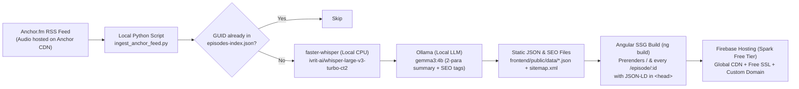

# PodStream.ai — $0/Month Local AI + Angular SSG Podcast Platform

A 100% free-to-operate, SEO-optimized podcast platform that runs **all AI transcription and summarization locally on your own computer** (no Gemini API, no Cloud Functions, no Firestore, no Cloud Run) and hosts the pre-rendered static site on **Firebase Hosting's Spark (Free) plan**.

Configured for: **[מי האיש החפץ חיים](https://anchor.fm/s/e7fc5d7c/podcast/rss)** (Rabbi Yannay's lessons on *Sefer Chafetz Chaim*).

---

## Architecture Overview ($0/Month Forever)



### Why This Costs Strictly $0/Month
- **Transcription:** Runs locally via [`faster-whisper`](https://github.com/SYSTRAN/faster-whisper) using the Hebrew-tuned [`ivrit-ai/whisper-large-v3-turbo-ct2`](https://huggingface.co/ivrit-ai/whisper-large-v3-turbo-ct2) model.
- **Summaries & SEO Keywords:** Runs locally via [Ollama](https://ollama.com/) (`gemma3:4b`), with an automatic `--skip-llm` / offline fallback so transcription always succeeds even if Ollama isn't running.
- **Database:** Static JSON files (`episodes-index.json` + per-episode `episodes/<id>.json`) committed right in your repo.
- **Hosting:** Static Angular SSG build deployed to **Firebase Hosting Spark (Free) plan** (10 GB storage, 360 MB/day transfer, no credit card required).
- **Audio Streaming:** Served directly from Anchor/CloudFront CDN via standard HTML5 `<audio>`.

---

## System Requirements

- **OS:** Linux, macOS, or Windows 11 (`publish.sh` for bash, `publish.ps1` for PowerShell)
- **CPU / GPU:** Modern multi-core CPU (using `--whisper-device cpu --compute-type int8`), or an NVIDIA CUDA GPU (`--whisper-device cuda --compute-type float16`)
- **RAM:** 8+ GB recommended when running `faster-whisper` (`ivrit-ai/whisper-large-v3-turbo-ct2`) alongside Ollama (`gemma3:4b`)
- **Runtime:** Python 3.10+ and Node.js 20+ (no separate system `ffmpeg` required; PyAV bundles FFmpeg libraries)

---

## Monorepo Layout

```text
podcast-platform/
├── backend/
│   ├── main.py                  # Local RSS parser, faster-whisper, Ollama & LocalEpisodeStore
│   ├── ingest_anchor_feed.py    # CLI entrypoint for the Anchor.fm feed
│   ├── requirements.txt         # Local Python dependencies (no cloud SDKs)
│   ├── test_ingestion.py        # Unit & integration tests
│   └── sample_feed.xml          # Offline sample RSS XML for tests
├── frontend/
│   ├── public/
│   │   ├── data/
│   │   │   ├── episodes-index.json # Catalog index (without full transcripts)
│   │   │   └── episodes/*.json     # Full episode JSON (with verbatim transcript)
│   │   ├── sitemap.xml          # Auto-generated XML sitemap
│   │   └── robots.txt           # Auto-generated robots.txt
│   ├── src/app/
│   │   ├── components/          # header, footer, audio-player (Signals)
│   │   ├── pages/               # home, episode-detail (/episode/:id)
│   │   ├── services/            # episode.service.ts (Signals), seo.service.ts (JSON-LD)
│   │   └── app.routes.server.ts # Prerenders / and all /episode/:id routes at build time
│   └── angular.json             # Configured with outputMode: "static"
├── firebase.json                # Firebase Hosting static config & cache headers
├── .firebaserc                  # Firebase project alias (set your project ID here)
├── publish.sh                   # One-command Linux ingest + build + deploy
├── publish.ps1                  # One-command Windows 11 ingest + build + deploy
└── README.md
```

---

## One-Time Setup

### 1. Python Dependencies (`faster-whisper`)
`faster-whisper` bundles PyAV/FFmpeg libraries, so you don't even need a separate system `ffmpeg` install.

**Linux:**
```bash
cd podcast-platform/backend
pip3 install --user --break-system-packages -r requirements.txt
# (Or inside a virtualenv: python3 -m venv .venv && source .venv/bin/activate && pip install -r requirements.txt)
```

**Windows 11 (PowerShell):**
```powershell
cd podcast-platform\backend
python -m venv .venv
.\.venv\Scripts\Activate.ps1
pip install -r requirements.txt
```

### 2. Ollama (Local Summarization & Keywords)
1. Install Ollama from [https://ollama.com/download](https://ollama.com/download) (available for both Linux and Windows 11).
2. Pull the lightweight Hebrew-capable model (fits comfortably in ~4 GB RAM):
   ```bash
   ollama pull gemma3:4b
   ```
   *(Optional on systems with 16+ GB RAM: `ollama pull qwen2.5:7b` and pass `--ollama-model qwen2.5:7b`.)*

### 3. Firebase CLI & Free Spark Project
1. Install the Firebase CLI (requires Node.js):
   ```bash
   npm install -g firebase-tools
   ```
2. Create a free Firebase project in the [Firebase Console](https://console.firebase.google.com/) (stays on the **Spark Free** plan—no billing account needed).
3. Authenticate and bind your project ID inside `podcast-platform/`:
   ```bash
   cd podcast-platform
   firebase login
   firebase use --add
   ```
   Or replace `YOUR_FIREBASE_PROJECT_ID` in `.firebaserc` and update `siteUrl` in `frontend/src/environments/environment.prod.ts` (and `--site-url`) to your `https://<your-project>.web.app` domain.

---

## Weekly Workflow (One Command)

Whenever you publish a new Monday lesson on Anchor:

**Linux:**
```bash
cd podcast-platform
chmod +x publish.sh
./publish.sh --max-episodes 3
```

**Windows 11 (PowerShell):**
```powershell
cd podcast-platform
.\publish.ps1 -MaxEpisodes 3
```

What happens automatically:
1. Checks `https://anchor.fm/s/e7fc5d7c/podcast/rss` and skips episodes already in `episodes-index.json`.
2. Downloads new `.m4a` audio, transcribes Hebrew locally via `ivrit-ai/whisper-large-v3-turbo-ct2`, and generates a 2-paragraph summary + SEO keywords via Ollama.
3. Updates `episodes-index.json`, `episodes/<id>.json`, `sitemap.xml`, and `robots.txt`.
4. Runs `npm run build` in `frontend/`, statically pre-rendering `/` and every `/episode/:id` route with `PodcastEpisode` + `AudioObject` JSON-LD baked into `<head>`.
5. Deploys `frontend/dist/frontend/browser` to Firebase Hosting.

---

## Backfilling All 145 Episodes Gradually

Because CPU transcription takes ~6–12 minutes per 35-minute episode, you can backfill in safe batches without redoing work (already-processed GUIDs are skipped automatically):

```bash
cd podcast-platform/backend

# Run 10 episodes overnight (only processes episodes not yet in episodes-index.json)
python3 ingest_anchor_feed.py --max-episodes 20

# If you want fast transcription-only without Ollama running:
python3 ingest_anchor_feed.py --max-episodes 20 --skip-llm
```

Then build & deploy once the batch finishes:
```bash
cd ../frontend && npm run build && cd .. && firebase deploy --only hosting
```

---

## Local Testing & Verification

```bash
# 1. Backend unit tests
cd podcast-platform/backend
python3 test_ingestion.py

# 2. Fast offline dry run against live Anchor RSS into a temp folder
python3 ingest_anchor_feed.py --max-episodes 1 --mock --output-dir /tmp/test_data

# 3. Build static Angular SSG site locally
cd ../frontend
npx ng build
```
